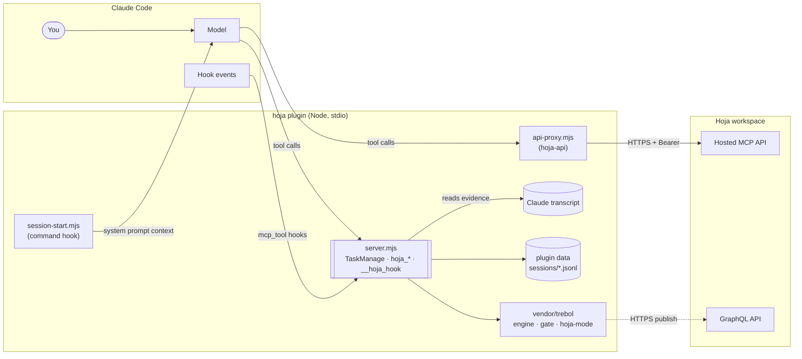
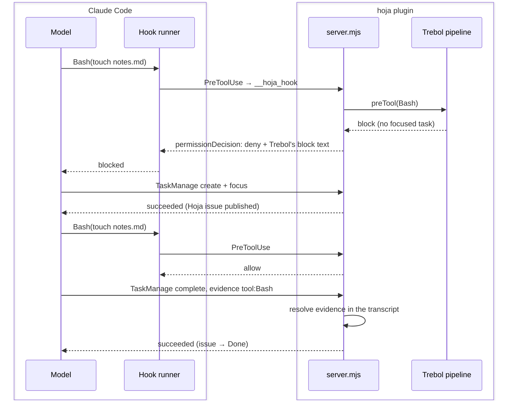

<div align="center">


# Hoja for Claude Code

**Tasks that can't be marked done without proof.**
Trebol's TaskManage, its task-enforcement gate and Hoja issue sync — as a Claude Code plugin.

[](LICENSE)
[](https://code.claude.com/docs/en/plugins)
[](#verify-it-yourself)
[](https://github.com/hoja-work/hoja-codex-plugin)

</div>

---

Agents say "done" too easily. Hoja makes "done" mean something:

- **Every task has acceptance questions.** "Do the tests pass?" "Is the README updated?" — written up front.
- **Completion needs evidence that resolves.** Each answer cites `src/app.ts#L10-L40`, `README.md#Install`, or
  `tool:Bash#3` — a real file or a real tool result from *this* session. Made-up evidence is rejected.
- **Nothing mutates without a task.** A gate blocks writes, edits and shell commands until a task is focused.
  Reads are always free.
- **Your tracker stays current by itself.** With Hoja mode on, each top-level task becomes a Hoja issue, its
  progress is rewritten in place, and an evidenced completion moves it to Done.

This is not a re-implementation. The engine, the gate and Hoja mode are
[Trebol](https://github.com/cloverinternational/trebol)'s own code, vendored byte-for-byte and hash-checked. The
plugin only translates between Claude Code's hooks and Trebol's runtime.

## Quick start

```text
/plugin marketplace add hoja-work/hoja-claude-plugin
/plugin install hoja@hoja
```

Claude Code asks for your Hoja endpoint and token (both optional — see [Configuration](#configuration)). Then just
work as usual. An abridged, illustrative session:

```text
> add a --json flag to the CLI

● Bash(touch src/cli/json.ts)
  ⎿  [TASK ENFORCEMENT - BLOCKED] YOU CANNOT EXECUTE ANY TOOL WITHOUT A TASK …

● hoja - TaskManage (create "Add --json flag", questions: flag-works, tests-pass; in_progress, active)
  ⎿  succeeded · published HOJA-712

● Bash(touch src/cli/json.ts) … Edit … Bash(npm test)

● hoja - TaskManage (completed · flag-works ← tool:Bash#4 · tests-pass ← tool:Bash#5)
  ⎿  succeeded · HOJA-712 → Done
```

Run `/hoja:setup` at any time to check your configuration.

## What you get

| | |
| --- | --- |
| **`TaskManage`** | Ordered, durable tasks with dependencies, sub-tasks, notes and 1–12 acceptance questions each. Completion is validated against the workspace and the session transcript. |
| **Task gate** | Trebol's Swarm hook pipeline: blocks non-read-only tools without a focused task (`block`), or only nudges (`advise`). Also: the completion nudge, the task-maintenance nudge, the bare-`sleep` blocker and the stdin-conflict guard. |
| **Auto-continue** | When a gate block ends the turn, Claude is sent back with exactly what to do, within the same bounded budget Trebol uses. |
| **Hoja mode** | `hoja_list`, `hoja_get` and `hoja_project`, plus automatic publication: one Hoja issue per coarse task, acceptance questions in the description, an evidence comment and Done on completion. |
| **Hosted Hoja API** | The workspace's full MCP API (70+ tools: issues, comments, decisions, projects, cycles) as a second server, `hoja-api`. Its **read** tools are exempt from the gate (see [Deviations from Trebol](#deviations-from-trebol)); its writes are gated and evidence-checked under the same names Trebol uses. |
| **Commands** | `/hoja:tasks` (task board), `/hoja:hoja on\|off\|status` (Hoja mode for this chat), `/hoja:setup` (diagnostics). All are answered locally, with no model turn — and `hoja_setup`, the same read-only report as a tool, is the fallback if a hook cannot run. |

## Configuration

Set values when Claude Code prompts on install (plugin `userConfig`), later with `/plugin configure hoja@hoja`, or
through environment variables. Every value is optional: without credentials, TaskManage and the gate still work and
publication is simply skipped.

| Setting (`userConfig`) | Environment fallback | Purpose |
| --- | --- | --- |
| `hoja_api_url` | `HOJA_API_URL` (deprecated alias: `LINEAR_API_URL`) | Hoja GraphQL endpoint, e.g. `https://hoja.example.com/graphql` |
| `hoja_mcp_url` | `HOJA_MCP_URL` | Hosted MCP endpoint. Derived from the GraphQL host when unset |
| `hoja_token` *(marked sensitive)* | `HOJA_TOKEN` (deprecated alias: `LINEAR_TOKEN`) | Personal API token |
| `hoja_project` | `HOJA_PROJECT` | Default project for publication. Also `.pi/config/hoja.json` in the repo |
| `task_enforcement` | `HOJA_TASK_ENFORCEMENT` | `block` (default) · `advise` · `off` |

Like Trebol, there is **no default endpoint**: Hoja calls fail closed with a message naming the variable to set.

## How it works

One MCP server process per session holds the task state, the gate and the Hoja client. It serves the tools *and*
receives every hook event, so all of them share memory — exactly as they do inside Trebol's Pi runtime.



A gated turn, end to end:



### Trebol → Claude Code mapping

| Trebol (Pi runtime) | Claude Code |
| --- | --- |
| `registerTool` (TaskManage, hoja_*) | MCP stdio server `dist/server.mjs`, with tools loaded upfront |
| `tool_call` block / pre-context | `PreToolUse` deny / `additionalContext` |
| `tool_result`, `turn_end` | `PostToolUse` (+`Failure`), `PostToolBatch` |
| `before_agent_start` system prompt | `SessionStart` command hook |
| `agent_before_settle` gate resume | `Stop` → `additionalContext` |
| `/tasks`, `/hoja` | `/hoja:tasks`, `/hoja:hoja`, answered by `UserPromptExpansion` |
| Session entries | `${CLAUDE_PLUGIN_DATA}/sessions/<id>.jsonl` plus the Claude transcript |

### Deviations from Trebol

The vendored code decides everything; the adapter only widens or re-routes four things Claude Code does differently.
Each one is covered by a test in `test/reported-bugs.test.ts`.

| Area | Trebol | Here | Why |
| --- | --- | --- | --- |
| Schema loading | — | `ToolSearch` is never gated | Claude Code defers MCP tools behind `ToolSearch`; gating it could make the gate's only exit (TaskManage) unreachable. |
| Read-only discovery | its own read tools (`hoja_list`, `hoja_get`, context, history, vault list/get) | also the hosted Hoja API's read tools (`hoja_viewer`, `hoja_workspace`, `hoja_teams`, `hoja_issues`, `hoja_projects`, `hoja_cycles`, `hoja_workflowStates`, `hoja_*Decisions`, inbox, labels, `hoja_extensionActions`, …), `hoja_project action:list` and `hoja_setup` | Trebol never sees the hosted API, so the gate refused a health check until an issue was filed. Writes (`hoja_issueCreate`, `hoja_taskUpdate`, `hoja_commentCreate`, `hoja_extensionActionRun`, `hoja_notificationMarkRead`, every `*Answer`/`*Update`/`*Delete`) stay gated. |
| Read-only Bash | `isBashReadOnly` over its tokenizer | the same call after dropping pure file-descriptor redirections (`2>&1`, `>&2`, `>/dev/null`, `&>/dev/null`) | Trebol's tokenizer reads the `&` in `2>&1` as a command separator, so `cat file 2>&1` looked like two commands. Redirects to real files are untouched, and Trebol's allowlist stays conservative (`|| true` is still not read-only). |
| Slash commands | `/tasks`, `/hoja` are Pi commands | `UserPromptExpansion` (any spelling of the command name) **and** a `UserPromptSubmit` fallback, plus the `hoja_setup` tool for the `.md` fallback | Claude Code fails a hook open when its plugin server is not connected; the command text then reached the model. Three independent paths now answer it. |
| Published issue content | `createIssue(title, description)` — no priority | the task's description is put at the head of the issue body when the create operation omitted it, and its priority is written with one `issueUpdate` after the create | `IssueCreateInput.priority` was never populated, so every issue kept Hoja's default. Only the create path is touched: Trebol's later description writes are proved by exact read-back, so a description added to a task *after* its issue exists still stays local (upstream behaviour). |


## Verify it yourself

```bash
git clone https://github.com/hoja-work/hoja-claude-plugin && cd hoja-claude-plugin
npm ci
npm run vendor:check   # 53 vendored files match vendor/MANIFEST.json (SHA-256)
npm test               # Trebol's own 25 suites, unmodified, plus the adapter tests: 355 tests
npm run validate       # claude plugin validate .
npm run eval           # live: the gate blocks an untasked write, the agent recovers, and plain questions create no tasks
```

To run the working tree directly: `claude --plugin-dir .`.

## Troubleshooting

| Symptom | Fix |
| --- | --- |
| `/hoja:setup` prints the command's fallback text | The hook could not run. The fallback now calls the read-only `hoja_setup` tool, so the report still prints when only the hook failed; if the tool is missing too, the server is down: `claude --debug=hooks,mcp` shows `MCP server "plugin:hoja:hoja"` and `Hook UserPromptExpansion`. |
| A read-only tool was refused by the gate | Read tools of the hosted API and `hoja_project action:list` are exempt. A tool that is not on that list (or a shell command Trebol's allowlist does not know) is gated by design — set `task_enforcement` to `advise`, or use plain `ls`/`cat`/`grep`/`git log` forms. |
| `hoja-api` serves no tools | No endpoint or token is configured. The tool list says which variable is missing. |
| Every write is blocked | That is the gate working. Ask Claude to create and focus a task, or set `task_enforcement` to `advise`. |
| Tasks are not published | Run `/hoja:hoja status` and `/hoja:setup`. Publication needs a token and a resolvable project. |

## Development

```text
src/            adapter: MCP server, hook bridge, Pi shim, transcript reader, API proxy
vendor/trebol/  Trebol files, byte-for-byte (never edit; re-vendor instead)
dist/           bundled entry points (committed, because plugins run without a build step)
hooks/          hooks.json — every event is forwarded to the server's __hoja_hook tool
commands/       fallback text for /hoja:* (normally answered by the hook)
evals/          claude plugin eval cases
test/           adapter tests (Claude and Codex hosts)
```

To re-vendor from a Trebol checkout, run `TREBOL_ROOT=~/src/trebol npm run vendor && npm run build && npm test`.

The [Codex plugin](https://github.com/hoja-work/hoja-codex-plugin) has the same adapter source, selected with
`HOJA_PLUGIN_HOST=codex`.

## License

[MIT](LICENSE). `vendor/trebol/` is unmodified code from
[cloverinternational/trebol](https://github.com/cloverinternational/trebol). See [NOTICE](NOTICE).
